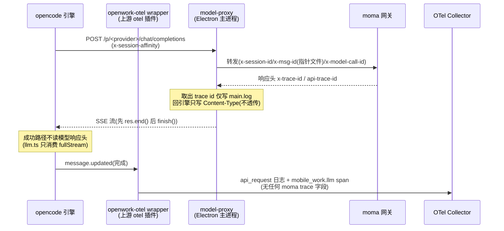
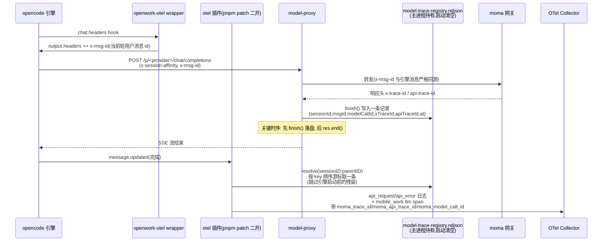
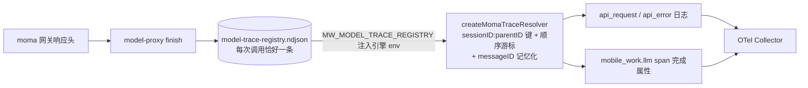

# feat(desktop): moma 模型 x-trace-id 写入 OTEL 遥测（日志 + llm span）

## 概述

moma 网关为每次模型调用在响应头返回 `x-trace-id` / `api-trace-id`，是网关侧排障的对账 id。此前该值只落在桌面主进程 model-proxy 的本地日志里，OTEL 遥测中不可见。

本 PR 打通「proxy → 引擎插件」的数据通道：model-proxy 在每次模型调用收尾把 trace id 写入本地 registry 文件；`@devtheops/opencode-plugin-otel` 经 pnpm patch 二开后按关联键消费 registry，给 `api_request` / `api_error` 日志和 `mobile_work.llm` span 追加三个字段：

- `moma_trace_id`（= 网关 `x-trace-id`）
- `moma_api_trace_id`（= 网关 `api-trace-id`）
- `moma_model_call_id`（= proxy 生成的调用 id，与上报/网关日志同源）

非 moma 模型、中止/连接失败的调用按设计**不加字段**（fail-open，绝不按时间窗猜测），原有遥测行为零变化。

## 变更图

### Before（完整流程）



### After（完整流程）



数据流补充（registry 通道）：



## 改动清单

**桌面侧（registry 生产端）**

| 文件 | 改动 |
|---|---|
| `apps/desktop/electron/mobilework/model-trace-registry.mjs` | 新增：NDJSON 追加写，启动清空，2MB 截断，全路径 fail-silent |
| `apps/desktop/electron/mobilework/model-proxy.mjs` | `pipeUpstreamToClient` 透传 session/msg 关联键，`finish()` 写 registry；**4 个 completed 分支统一先 finish() 后 res.end()**（修时序竞态） |
| `apps/desktop/electron/desktop-path-context.mjs` | runtime 区新增 `modelTraceRegistryPath` |
| `apps/desktop/electron/main.mjs` | 启动时初始化 registry（model-proxy 启动前） |
| `apps/desktop/electron/runtime.mjs` | `buildChildEnv` 注入 `MW_MODEL_TRACE_REGISTRY`（覆盖内嵌 server 与 direct runtime 两条引擎路径） |

**插件消费端**

| 文件 | 改动 |
|---|---|
| `patches/@devtheops__opencode-plugin-otel@1.5.1.patch` | 新增 `createMomaTraceResolver`（mtime+size 缓存、坏行跳过、顺序游标、messageID 记忆化、模块加载时刻过滤残留、fail-open）；api_request/api_error 日志与 llm span 完成属性三处 spread |
| `apps/server/src/opencode-plugins/otel-core.ts` | `chat.headers` 转发处注入 `x-msg-id`（当前轮用户消息 id，与 assistant.parentID 同源）；头注更新 |
| `apps/server/AGENTS.md` | openwork-otel 段更新为二开版本说明 |
| 测试 | `model-trace-registry.test.mjs`(8)、`model-proxy.test.mjs`(+4，含确定性排序回归)、`openwork-otel-moma-trace.test.ts`(8)、`openwork-otel.test.ts`(+3) |

**随修复解决的三个实机缺陷**（均有变异验证的回归测试）：

1. proxy 完成分支 `res.end()` 先于 `finish()` → 引擎抢在 registry 落盘前查询，偶发丢字段；
2. registry msgId 原取自 current-turn 指针文件，指针滞后于请求 → 关联键错位；改为 chat.headers 注入真实消息 id（指针降级兜底）；
3. resolver 的 at 过滤基准取在首次 resolve 时刻 → 每个引擎进程首条完成消息必丢字段；基准提到插件模块加载时刻。

## 测试命令与结果

```bash
# 桌面侧
node --test apps/desktop/electron/mobilework/model-trace-registry.test.mjs  # 8/8 pass
node --test apps/desktop/electron/mobilework/model-proxy.test.mjs           # 84/84 pass
node --test apps/desktop/electron/desktop-path-context.test.mjs             # 5/5 pass
pnpm --filter @mobilework/desktop typecheck:electron                        # pass

# 服务端
cd apps/server && bun test src/opencode-plugins/   # 339/339 pass（含新增 17 例）
cd apps/server && bun test src/                    # 无 otel 相关新增失败
                                                   # （失败集为既有基线子集：connector/knowledge 等
                                                   #  环境超时类，逐 run 波动，与改动无关）
cd apps/server && pnpm build                       # pass；产物 dist/opencode-plugins/openwork-otel.js
                                                   # 可 grep 到 moma_trace_id（patch 已内联）
cd apps/server && pnpm verify:node-runtime         # 10/10 pass

# 冒烟与文档
pnpm test:health && pnpm test:sessions && pnpm test:events && pnpm test:permissions  # 全 pass
pnpm test:docs                                     # 3/3 pass
pnpm typecheck                                     # 19 error，均为既有基线（docs/pre-pr-test-checklist.md
                                                   # 已记录 apps/app 基线红灯），全部位于本次未触碰文件，
                                                   # 较基线无新增
```

## 桌面端实测（pnpm dev + 本地 LGTM）

- 环境：本地 arm64 重建版 `haiops-agent-lgtm`（Grafana :13000 / OTLP :43180），`MW_OTEL_PLUGIN_ENDPOINT` 指向本地
- 发多条 moma 消息（含同轮多调用）：Grafana Loki 的 `api_request` 与 Tempo `mobile_work.llm` span 均带正确 `moma_trace_id`，与 main.log `stream_end`、registry 三方一致；同一轮两次调用按序各取各的 trace id
- 回归核对：日志类型集合、`api_request` 原有 attributes、traces、16 个 `mobile_work.*` 指标与改动前完全一致；无匹配记录（中止的 api_error、非 moma）保持原样无字段
- 注入正确性：proxy `gateway_trace_headers` 日志确认出站 `x-msg-id` 与引擎消息 id 逐字节一致

## 影响面与边界

- 非 moma 模型（bearer 直连 / 聚智）：registry 不写、resolver 查不到，行为与改动前完全一致；唯一差别是所有模型请求多带一个 `x-msg-id` 请求头（OpenAI 兼容 API 忽略之）
- registry 文件随应用启动清空，引擎重启不丢对齐语义（模块加载时刻过滤残留）
- 已知边界：connect 阶段失败的调用无 registry 记录（此时引擎通常也不产出 api_request/api_error，不错位）；registry 超 2MB 截断为重对齐基准（数千次调用的量级，接受）
- 上报地址零改动：endpoint 仍由入库 `.env.uat` / `.env.prod` 决定，本 PR 不含任何环境配置变更
