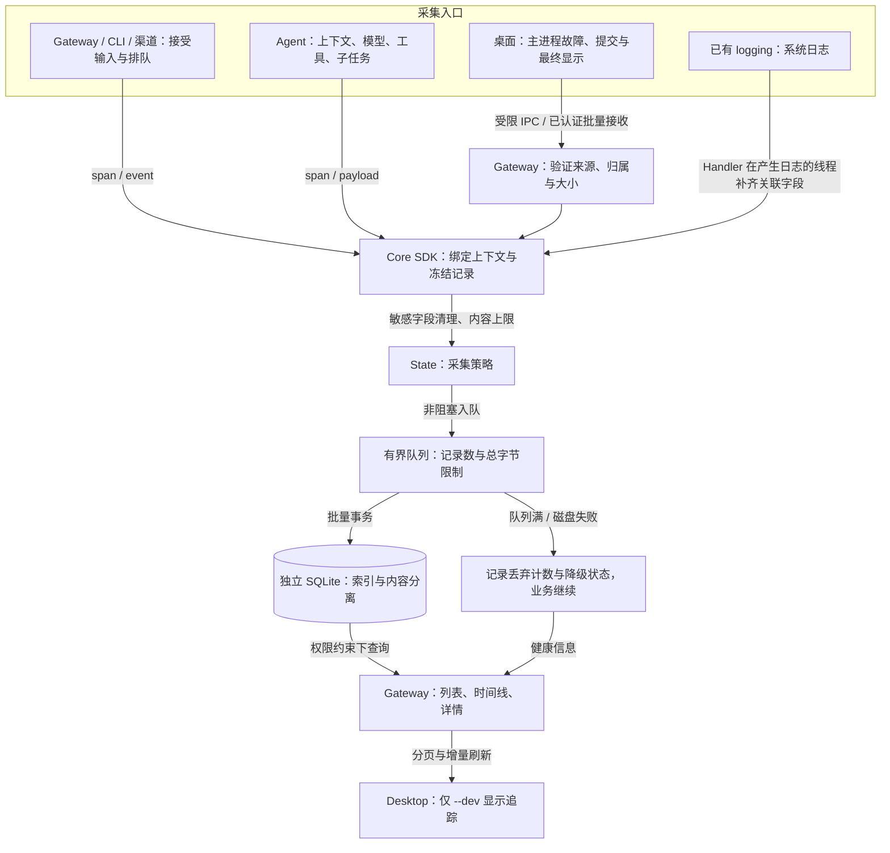
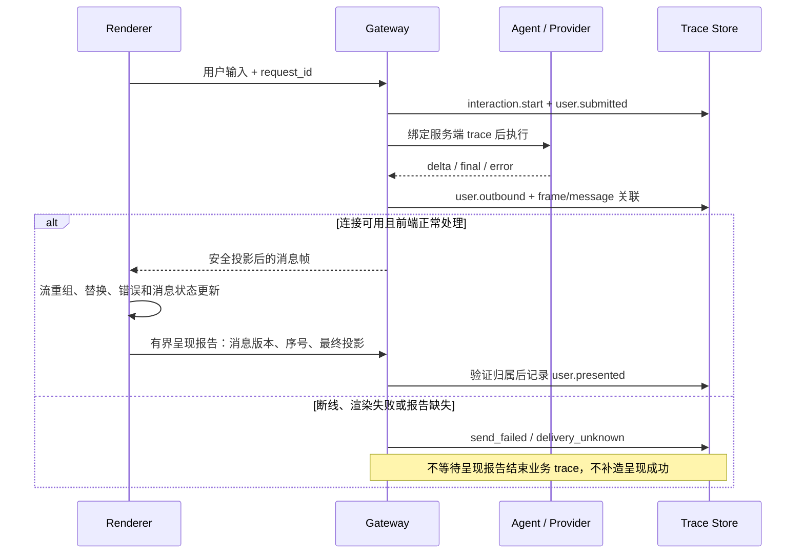
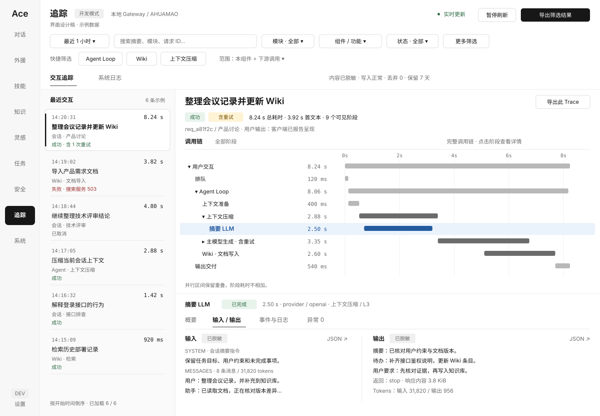
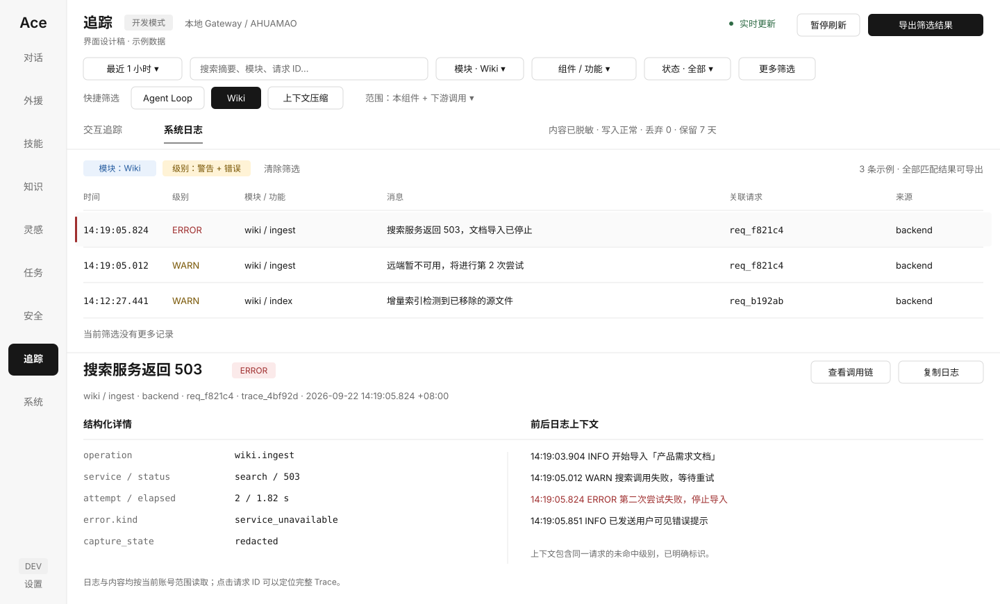
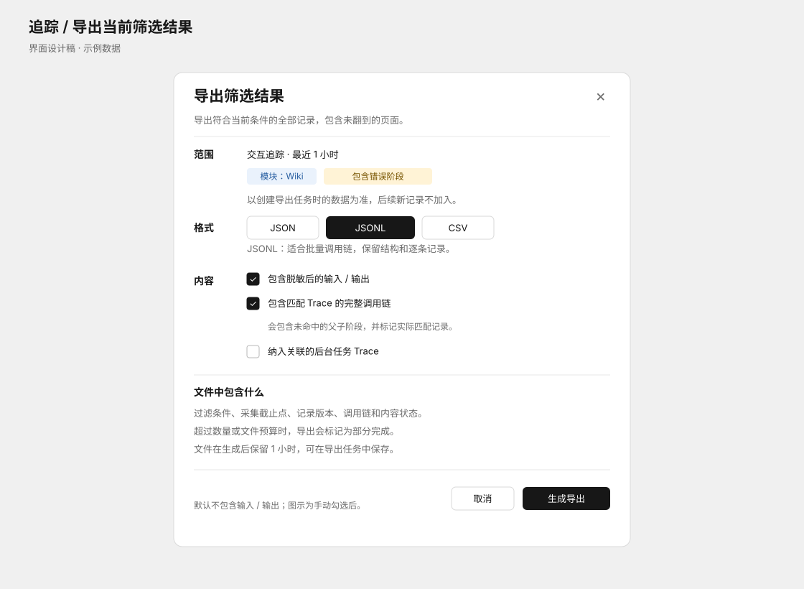

# Ace 开发者可观测与追踪技术方案

> 状态：待实施；本文不代表功能已完成。调研日期：2026-09-22。  
> 范围：桌面端侧边栏「追踪」、系统日志、用户交互调用链、耗时、LLM / 工具 / 服务输入输出。  
> 已确认：沿用桌面 `--dev` 开发启动模式显示入口，不增加设置中的开发者模式开关。  
> 源码基线：Ace `aad44cf`、dsh `73b2779a19`；以调研时工作区内容为准。工作区已有其他未提交修改，本次不修改功能代码。

## 1. 实施结论

**需要统一的观测 SDK，但不需要重新造一套业务日志 API，也不需要首版部署独立日志服务器。**

保留现有 `get_logger()`，让已有日志自动携带调用上下文；新增轻量 `span()`、`event()`、`capture_payload()` 接口，供需要记录阶段耗时和输入输出的模块导入。用有界异步写入器将数据存入独立 SQLite 库，再通过 Gateway 查询接口驱动桌面追踪面板。

第一版交付完整闭环：开发启动 → 用户提交 → 排队 → 构建上下文 → LLM / 工具 / 外部服务 → 出站消息 → 前端最终呈现。普通启动不出现追踪入口；查询接口另行验证后端是否允许开发诊断及当前身份，不能把隐藏按钮当权限控制。

方案按以下责任组织，保持现有模块边界，不新增顶层业务模块或单独发布的 Python 包。

| 层 | 本次新增的职责 | 归属 |
|---|---|---|
| 业务埋点接口 | 上下文、span 生命周期、事件、可替换 sink | `core` |
| 数据基础设施 | 结构化日志桥接、脱敏、异步队列、SQLite、清理 | `state` |
| 组装与生命周期 | 初始化、关闭、诊断配置与资源回收 | `app` |
| 采集边界 | 请求、LLM、工具、MCP、浏览器、渠道、子任务 | 各原有模块 |
| 查询与接收 | 权限检查、筛选分页、详情、桌面事件接收 | `gateway` |
| 开发者工作台 | 侧边栏、trace 列表、瀑布图、输入输出、系统日志 | `desktop` |

这是一套贯穿模块的基础设施；新增产品页面叫「追踪」，不是把所有业务代码搬进一个新的大模块。

## 2. Ace 现状与需要补齐的能力

### 2.1 已有能力可以保留

| 已核对的现状 | 可以复用的部分 | 与目标的差距 |
|---|---|---|
| `get_logger()`、Rich 控制台、可选文件日志 | 日志调用方式与命名空间 | 普遍缺少结构化 trace / span 关联 |
| `RingBufferHandler`，默认 2,000 条；系统日志 API 支持级别、关键词、分页 | 现有系统日志入口与账号隔离规则 | 内存记录跨重启丢失，没有阶段时间线 |
| `llm_trace()`、后台 QueueListener、`llm.jsonl` | 已有 LLM / 工具采集位置与兼容入口 | 队列无容量上限；无统一请求树；不是完整协议请求快照 |
| 会话 `debug-log` API 精确匹配 session 和 owner | 隔离逻辑及测试 | 每次从头扫描 JSONL，读取内存有界，但查询耗时随文件增长 |
| `runctx` 中已有 request、session、owner、tool、task 等 ContextVar | 身份与业务关联字段 | 缺少统一 trace/span；跨队列消费者不能依靠自动继承 |
| `session_events` 保存会话事件与恢复信息 | 对话消息、持久事件序号、回合关联 | 是业务事实来源，不宜塞入大量调试载荷 |
| 执行器、provider、工具已有部分 `[PERF]` 日志 | 定位阶段边界 | 文本耗时不等于可计算的嵌套/并行 span |
| 桌面主进程与 renderer 有 stream-debug、错误日志 | 桌面故障采集位置 | 未形成后端到最终显示的一条链 |

当前 `runtime.llm_trace` 的配置默认值为 `True`。因此不能在迁移时把“追踪页隐藏”解释成“从未采集过内容”，也不能悄悄改掉已有用户的采集配置。

### 2.2 不能直接把现有 JSONL 做成表格

几个具体缺口决定了需要统一 SDK：

1. **session 不是一次请求。** 同一会话会有多个回合、并行子任务、内部执行会话和外层显示会话；需要独立 trace 与明确的关联字段。
2. **当前请求记录不等于完整的模型输入。** OpenAI 路径记录 messages 和工具名称，但并未完整记录最终请求参数及工具 schema；Anthropic 非流式记录 messages，system 是独立字段，流式路径也没有对称的请求记录。应在 provider 完成协议转换后采集。
3. **模型输出、工具原始结果和用户显示内容不同。** 过滤、截断、流合并、`replace_content`、错误状态都会改变显示结果。
4. **耗时有重叠。** 目前执行器允许模型流式生成期间提前执行部分工具；把 LLM 时间和工具时间相加会高估总耗时。
5. **工作队列会断开上下文。** MCP 的常驻 worker 从队列取请求执行，不能假设它自动继承入队者的 ContextVar。
6. **日志失败不应拖垮业务。** 无界队列、完整内容递归序列化、同步磁盘写入，都需要可量化的资源限制。

## 3. dsh 调研与设计取舍

调研由 Luna 子代理完成，主代理复核关键源文件。dsh 的相关能力分成 **会话事件事实、遥测导出、查询索引、Trajectory 展示** 四层，不能把它们当成一个现成的通用日志面板。

| 已验证的 dsh 机制 | 对 Ace 的价值 | Ace 的适配边界 |
|---|---|---|
| Session.append 对数据做 JSON 快照/校验，分配连续 seq 和 time，再通知事件订阅者；持久化监听器异步工作 | 接受记录时冻结内容，事件有顺序，采集与 I/O 分开 | dsh 的 Session 是业务事实来源，校验可以拒绝业务事件；Ace 调试记录失败必须隔离，不能改变会话执行 |
| 事件包含 turn/step、user/system/assistant、attempt、tool call/result、request header/context | 从一次交互钻入模型实际上下文和工具输入输出 | Ace 使用自己的 trace/span，关联已有 session_events；不移植 dsh 的 surface/replacement 事件协议 |
| telemetry coordinator 用 cursor 捕获 canonical session log，经 redaction waterfall 交给 backend | 采集策略与 sink 解耦；同一事件有稳定身份，便于去重 | dsh 的 telemetry seam 不内置通用脱敏规则；Ace 必须落实自己的采集策略，不能把可插入 hook 当作已脱敏 |
| session-query 提供有界窗口、cursor、AND/OR 元数据过滤、文本搜索；SQLite provider 含 FTS5、参数化查询与过滤预算 | 查询是独立投影，筛选语义与容量限制属于 API 契约 | dsh 已有的事件过滤维度不是 Ace 的 Agent Loop/Wiki/Compact 分类；Ace 要新增明确 module/component/operation 标签 |
| Trajectory 提供 turn 视图、表格、时间线、搜索、输入输出详情、TTFT/总耗时与 usage | 总览 → 时间线 → 详情的排障路径、按需历史加载与大列表处理 | 其 React/store 与 Session projection 绑定；Ace 在自己的 desktop 页面机制内实现，不引入第二套前端运行时 |
| sidebar-right 通过注册表装配入口 | 页面可插拔与生命周期归属 | Ace 使用已有左侧 ShellNavigationRegistry；dsh 的 build profile 示例不是开发者访问权限 |

特别区分两点：

- 当前 dsh 的 OTel backend 是**反馈授权后的会话日志外发**，模式为 FEEDBACK_ONLY / DISABLED，采用尽力交付，并非通用本地 span 数据库。Ace 此需求不以外发为前提，不能直接把该 backend 当本地可观测实现。
- Trajectory 中的点击、搜索与选中逻辑不构成一个通用的前端呈现遥测管道。Ace 要看到“用户实际提交/最终呈现”，仍需自己的消息投影与呈现报告。

因此首版选择轻量内部 SDK + 本地 SQLite：已有 Python logging 和 SQLite 可以承接，dsh 的分层思想可用于接口设计。OTel 导出留在可替换 sink 层；业务代码不依赖 collector，也不为未来导出提前引入整套服务。

调研入口：

| 主题 | dsh 源码 |
|---|---|
| 事件接受、快照与发布 | [Session.append](/Users/ahuamao/Documents/Codes/deepseek-harness/packages/core/session/src/index.ts:667)、[事件类型](/Users/ahuamao/Documents/Codes/deepseek-harness/packages/core/session/src/types.ts:269) |
| 持久化机制 | [session-persistence](/Users/ahuamao/Documents/Codes/deepseek-harness/packages/session/session-persistence/README.md:57) |
| 捕获 cursor 与策略 seam | [coordinator.ts](/Users/ahuamao/Documents/Codes/deepseek-harness/packages/session/session-telemetry/src/coordinator.ts:60) |
| OTel 模式与外发边界 | [session-telemetry-otel](/Users/ahuamao/Documents/Codes/deepseek-harness/packages/session/session-telemetry-otel/README.zh.md:1) |
| 过滤契约 | [types.ts](/Users/ahuamao/Documents/Codes/deepseek-harness/packages/session-query/session-query/src/types.ts:200) |
| SQLite 检索与预算 | [schema.ts](/Users/ahuamao/Documents/Codes/deepseek-harness/packages/session-query/session-query-sqlite/src/schema.ts:127)、[query.ts](/Users/ahuamao/Documents/Codes/deepseek-harness/packages/session-query/session-query-sqlite/src/query.ts:24) |
| 交互追踪面板 | [TrajectoryView.tsx](/Users/ahuamao/Documents/Codes/deepseek-harness/packages/client/ui-trajectory/src/client/TrajectoryView.tsx:1)、[TrajectoryTimeline.tsx](/Users/ahuamao/Documents/Codes/deepseek-harness/packages/client/ui-trajectory/src/client/TrajectoryTimeline.tsx:1) |
| 可插拔侧栏 | [tab-registry.ts](/Users/ahuamao/Documents/Codes/deepseek-harness/packages/client/ui-sidebar-right/src/client/tab-registry.ts:1) |

## 4. 总体架构与模块接口

### 4.1 一条数据路径，多个采集入口

业务模块只依赖观测接口；SQLite、HTTP 路由、Electron 都不能被 SDK 反向依赖。下图同时说明了正常记录与存储异常时的行为。



常规系统日志仍可输出到控制台和原有文件。新增存储是追踪面板的查询来源；它不成为会话恢复或工具执行的必要条件。

### 4.2 最小实现结构

以下是**拟新增文件**，不是当前源码已有能力。实现时以模块内聚为准，不为每个埋点创建一个文件。

| 文件 | 职责 |
|---|---|
| `crew/core/observability.py` | SDK、上下文值对象、sink 协议、NoopSink、span/event/payload 接口；仅依赖标准库和 core |
| `crew/state/observability.py` | recorder、队列与 writer、脱敏与限额策略、启停及状态；不依赖业务模块 |
| `crew/state/trace_store.py` | SQLite schema、批量提交、索引查询、内容读取、保留与迁移 |
| `crew/gateway/routers/tracing.py` | trace / logs / payload / status / ingest API 与统一权限依赖 |
| `desktop/src/ui/api/feature-tracing.ts` | DTO、过滤参数与查询客户端 |
| `desktop/src/ui/features/tracing.ts` | 页面注册与生命周期、筛选、列表、瀑布图、详情；复杂度增长后再拆内部子模块 |
| `desktop/src/shared/observability.ts` | TS 事件 schema、显式上下文、小型有界批量队列；主进程和 renderer 可复用，不依赖 DOM/Node 文件 API |
| `desktop/assets/styles/components/tracing.css` | 页面局部样式，复用现有设计 token |

启动与装配放在现有 App；导航注册放在现有 ShellNavigationRegistry。通过依赖注入切换 recorder / NoopSink，后续增加导出 sink 时不改业务调用者。首版不把本地诊断包装成额外工作区发行包。

### 4.3 SDK 应提供的最小契约

| 接口 | 行为与约束 |
|---|---|
| `bind_observation(context)` | 绑定当前调用的关联信息；退出必须 reset token，不能污染下一请求 |
| `span(name, kind, attributes=...)` | 上下文管理器；启动和终止均记录；异常、取消、超时有明确终态；不吞掉业务异常 |
| `event(name, attributes=...)` | 记录某时刻发生的事实；无耗时，不用事件假装 span |
| `capture_payload(stage, value, policy=...)` | 接收实际数据，按策略清理并冻结；返回内容引用或明确的未采集原因 |
| `capture_context()` / `attach_context()` | 为队列、线程、子进程和异步后续任务显式携带最小上下文 |
| `flush(timeout)` / `close(timeout)` | 测试与关闭时等待已接受记录；有截止时间且幂等；不在单条业务请求中调用 |

业务接入示意，名称为拟定 API：

```python
from crew.core.observability import span, event, capture_payload
from crew.state.logging import get_logger

log = get_logger("providers.search")

with span("service.search", kind="client", attributes={"service": "search"}):
    capture_payload("service.request", request_body)
    result = await search_client.search(request_body)
    capture_payload("service.response", result)
    event("service.completed", attributes={"result_count": len(result.items)})
    log.info("搜索服务完成")
```

API 支持在 `async` 函数内使用同步上下文管理器；进入退出只做轻量内存操作，不能同步写盘。对异步生成器，跨度必须覆盖**实际迭代和关闭**，而非仅覆盖生成器对象的创建；使用显式关闭/finally 收尾，测试停止消费、取消和异常路径。记录 span 存活期间与“当前激活上下文”是两回事：生成器向调用者 yield 前要恢复调用者上下文，下一次迭代时再 attach，避免 provider span 泄漏到调用者的工具派发/出站处理。

日志接入只增加一个桥接 Handler。关联字段必须在生产线程或任务中填入记录，writer 不再读取 ContextVar；第三方日志没有已验证归属时列为进程系统事件。已有 `log.info()` 不要求逐处改写。

## 5. Trace 语义、上下文与耗时

### 5.1 根 trace 的边界

**一次接受的用户操作对应一条根 trace**，从服务端接受输入开始，覆盖排队、执行和出站准备；前端提交与显示通过 request_id / 已验证的 trace 关联加入时间线。

| 场景 | 处理规则 |
|---|---|
| 普通请求 | 接受时创建服务端 trace；内部执行沿用；网关之外的 CLI 入口由 App 在无当前上下文时创建 |
| 同会话第二条排队请求 | 新 trace；记录自己的 session_queue_wait 和 global_queue_wait |
| steer 补充输入 | 新输入操作 trace，用 link 指向被影响的运行 trace；补充文本成为被影响 trace 的事件，不冒充原始输入 |
| interrupt / 用户取消 | 控制操作有独立事件；被取消执行关闭所有活跃 span，保留已产生内容和取消原因 |
| 同步/本轮等待完成的子 agent | 当前 trace 下的独立 child span，子 session 与显示 session 分开记录 |
| 脱离父回合运行的后台任务 | 新 trace，link 指向发起 span；不让父回合耗时包含几小时后台工作 |
| 重试、fallback、续写 | 每次实际 provider 调用一个新 span，共享 logical_call_id，记录 attempt 和 fallback 序号 |
| 外部 agent | 记录可观察到的调用、协议事件和回包；没有内部 trace 时标为黑盒，不虚构其内部 LLM 耗时 |
| 重启后的未结束记录 | 标记 `incomplete` / `process_lost`；不填造假的正常结束时间 |

执行状态使用 `queued/running/succeeded/failed/cancelled/timed_out/incomplete`；记录质量 `complete/partial` 和投递状态独立保存。一次失败重试或被正常处理的工具错误不会自动把根操作判为失败，另有 `has_error_span` 供筛选；根状态取最终业务结果。主动停止与未处理异常分开显示。

trace ID 使用随机 128 bit，span ID 使用随机 64 bit 的非零十六进制值；保留 request_id 为业务关联键，不能用 session 字符串前缀拼出父子关系。ID 形态及 parent/link 概念与 [OpenTelemetry Trace API](https://opentelemetry.io/docs/specs/otel/trace/api/) 对齐，但首版自有记录格式不宣称已实现 OTLP。

### 5.2 关联字段与可信来源

| 字段 | 含义 |
|---|---|
| `trace_id / span_id / parent_span_id / links` | 调用树与跨 trace 因果关系 |
| `owner_account_id` | Gateway 认证或受信入口解析出的归属；禁止从客户端 payload 信任该字段 |
| `workspace_id` | 请求所属工作空间 |
| `session_id` | 外层用户可见会话 |
| `execution_session_id` | 本次内部执行/sidechain/子 agent 会话 |
| `request_id / message_id / session_event_seq` | 用户请求、显示消息、业务事件关联；事件 seq 仅作关联，不复用为观测全局序号 |
| `task_id / parent_task_id / agent_id / tool_call_id` | 后台任务、子 agent、具体工具调用 |
| `source / process_instance_id / origin` | backend、desktop.main、desktop.renderer、channel，以及每次进程启动实例 |
| `module / component / operation / feature_id` | 记录产生模块、模块内组件、具体操作与可选插件/产品能力；用于 Agent Loop、Wiki、上下文压缩等精确筛选 |
| `schema_version / capture_policy_version` | 记录版本和内容策略版本 |

无请求的启动、数据库初始化、进程退出等系统日志允许 trace 为空；必须明确标识 system scope。多 owner 环境不能把任意工作线程中默认的 `local` 身份当作已验证业务 owner。

传播规则：

- Python 普通嵌套调用沿用 ContextVar；每个并行工具在自己的任务内创建 child span，不能共享可变“当前 span”。
- `asyncio.create_task` 在创建时捕获的上下文只代表当时状态；后台任务需要显式决定 child 还是 linked root，结束后清理继承状态。
- `asyncio.to_thread` 可以承接上下文；原生线程、自建 executor、长期队列消费者必须显式传递并在执行作用域 reset。
- MCP `_CallRequest` 增加不可变的 observation context；worker 出队时 attach，分别记录排队和远端执行，下一请求前恢复原上下文。
- TS 不用跨 `await` 的全局可变 currentTrace；请求和消息处理函数显式传 context。IPC / WS 接收端重新校验 request 与 owner 的关系。
- 不把用户正文或认证信息装进传播字段；第三方服务未约定支持时不强行注入追踪 header。跨进程时只传 ID 和必要关联。

### 5.3 时间定义

持久时间使用 UTC epoch 微秒；本进程耗时用 Python `perf_counter_ns()` / TS `performance.now()` 计算后转为毫秒。跨进程时间轴按墙钟近似排列并保留 process 标识，不用两台机器的 monotonic 值相减。

| 指标 | 准确定义 |
|---|---|
| `server_total_ms` | 服务端接受操作至业务执行结束并完成出站准备；不等待 renderer ACK |
| `queue_wait_ms` | 会话排队与全局并发名额等待分别记录；不算 LLM 耗时 |
| `duration_ms` | 当前 span 本进程实际起止差 |
| `self_ms` | span 时长减去落在其区间内、同一时钟域直接子 span 区间的并集；不得直接减各子 span 时长之和 |
| `llm_first_event_ms` | provider 开始请求至首个有效流事件 |
| `llm_first_text_ms` | provider 开始请求至首个用户正文文本增量；与 reasoning / tool 事件区分 |
| `llm_total_ms` | 完整请求直到流消费结束或失败，包含等待建立响应流的时间 |
| `ui_first_presented_ms` | renderer 从提交到首个内容进入渲染状态并经过下一绘制调度的本地耗时 |
| `ui_final_presented_ms` | renderer 从提交到最终消息状态提交并经过绘制调度的耗时 |

跨机器或缺少子 span 的 `self_ms` 显示 unavailable / partial。首版给出 span 树和并行区间，不声称已经计算可靠的完整关键路径。

例：根请求 8 秒，LLM 6 秒、工具 4 秒，其中重叠 3 秒，二者占用区间是 7 秒。面板不能显示成“模型 6 秒 + 工具 4 秒 = 总计 10 秒”。

## 6. 埋点范围与输入输出语义

### 6.1 每个层级只拥有自己的 span

| 层级 | 首版记录内容 | 采集边界 |
|---|---|---|
| 用户输入 | 原始提交文本、附件名称/类型/大小/引用、操作类型 | 入口验证后、注入提示词之前 |
| 排队与路由 | 接受、会话排队、全局等待、驱动选择、拒绝原因 | Dispatcher / App |
| 上下文准备 | 历史加载、附件处理、技能/记忆/插件上下文、压缩 | Agent runtime 与对应上下文贡献边界 |
| LLM 逻辑调用 | 迭代序号、请求中间件、重试退避、fallback | BuiltinExecutor 与辅助模型入口 |
| LLM 实际调用 | 协议请求、响应、首事件、首文本、usage、状态、错误 | OpenAI / Anthropic provider；每次应用层实际调用 |
| 工具调用 | 参数验证、权限等待、执行、结果过滤、截断与错误 | ToolRunner；raw 与投影内容不同 stage |
| 外部服务 | 服务名、操作、脱敏 endpoint、请求/响应、状态、耗时 | MCP worker、搜索 provider、浏览器 bridge、渠道 adapter 等已有客户端边界 |
| 子 agent / task | 创建、开始、完成、收集、父子关系 | 现有子任务/后台任务运行边界 |
| 用户输出 | 出站安全投影、发送结果、renderer 呈现投影 | outbound / connection / renderer |
| 系统运行 | 启停、后台服务、连接、配置加载错误、数据库失败、桌面进程故障 | logging Handler 与桌面已有错误处理入口 |

已有 span 层次应可从一条失败用户操作走到具体服务。例如：`interaction → agent.turn → tool.call → service.mcp.call`。不能在 executor、辅助函数和 provider 各记一条相同 `llm.call`，造成三倍请求数；逻辑编排 span 和 provider 实际调用 span 使用不同 kind。

所有调用 LLM 的入口都在范围内，包括主 agent、子 agent、摘要、标题、压缩及其他辅助模型。对 SDK 自带且未暴露的网络级重试，标注 `internal_attempts=unknown`；只有接入 transport hook 后才展示每次网络 attempt，不把一次 Python 方法调用伪称为唯一 HTTP 请求。

首版“各种服务”的验收范围为：当前 OpenAI/Anthropic 路径、MCP、搜索服务、浏览器 Electron bridge、桌面主进程与 Gateway 通信、渠道出站、外部 agent 适配器。其他服务接入同一 SDK，并在 coverage 清单明确是否已埋点；不能仅覆盖 LLM 却宣称全链路完成。

### 6.2 输入输出必须区分阶段

| stage | 记录什么 | 不应混淆的内容 |
|---|---|---|
| `user.submitted` | 用户实际提交的文本与附件元信息 | 不包含系统拼接的提示词 |
| `llm.request` | provider 完成转换后的实际请求：system/messages、完整 tools schema、模型、温度、限制、格式、reasoning 参数等 | 不是转换前 Message 对象或仅工具名列表 |
| `llm.response` | provider 可观察响应内容、tool calls、finish reason、usage、可用的请求标识 | 和实际显示正文分开；不推断服务没有返回的信息 |
| `tool.input` | 最终执行参数的脱敏副本 | 不冒充 UI 卡片的摘要参数 |
| `tool.output.raw` | 客户端返回后、工具结果截断前的受限内容 | 不替代工具返回给模型的内容 |
| `tool.output.model` | 经过策略/截断、真正进入模型的结果 | 可与 raw 对照解释信息损失 |
| `service.request/response` | 具体服务边界的结构化调用和结果 | HTTP header 只收允许字段，凭据不进库 |
| `user.outbound` | 输出过滤、消息替换规则生效后的出站内容 | 表示准备交付/已发送，不表示已经显示 |
| `user.presented` | renderer 消息模型中的最终正文、可见错误、工具摘要与附件引用 | 标为“客户端报告已呈现”，不是用户已阅读证明 |

“完整”只指策略允许且未超出大小限制的内容。每份载荷必须携带 `capture_state`，取值包括 complete、redacted、truncated、disabled、dropped；同时返回 redacted_paths、truncated_reason、observed_size、stored_size。长度来自有界遍历时需标明是否精确，不为测原始大小而全量序列化巨大对象。

额外记录 `capture_layer=provider_arguments|transport_body|assembled_response|presentation`。SDK 入参快照可能未包含 SDK 后续补齐的默认值，流式拼装结果也不是原始网络字节；面板不能统称为“原始 HTTP”。首版必须有 provider 完成协议转换后的参数和完整拼装响应；可控 transport 边界若已接入则另存脱敏请求/响应体，不重复消费响应流，也不记录认证 header。

二进制、图片 base64、视频等不直接灌入日志库；记录媒体类型、大小和受权限保护的引用。现有浏览器页面内容、表单值和图片脱敏规则继续生效，不能借“开发模式完整记录”绕过。

### 6.3 如何确认最终显示内容

后端出站投影和前端最终呈现分别留证。数据流程如下，断线或错误不能被记为“已显示”。



呈现报告取**规范消息状态**，不抓整个 DOM / HTML。报告包含 client_instance_id、request_id、message_id、revision、frame 范围、最终投影和本地耗时。若尚无稳定 message_id，先在消息状态层建立稳定关联，不使用临时 DOM 节点 ID。

服务端按身份、会话访问权和 request 归属验证报告；同消息版本幂等，多客户端分别保存，不覆盖彼此；报告晚到可更新 delivery 状态，但不重开已结束执行 span。通用接收接口不允许客户端伪造 provider/system 事件。

流式阶段保存首事件、首文本、结束、错误及必要的有界内容片段，默认不为每个 token 建 span 或逐条写盘。前端停止、替换最终内容、WS 回放去重、切换会话和无 final 的中断路径都要产生正确投影。

## 7. 存储、查询性能与故障处理

### 7.1 使用独立 SQLite 库

建议默认存储位置为 `get_crew_home()/observability/traces.sqlite3`，复用现有 home 解析，不依赖启动 cwd；桌面 `--dev` 的隔离 home 随现有启动机制生效。单库多 owner 时所有查询与关联键必须带 owner 条件，system scope 单独处理。

| 表 | 内容与关键约束 |
|---|---|
| `traces` | 根操作摘要、状态、起止、显示 session、错误和 token 摘要、quality、delivery 状态；唯一 `(owner_scope, trace_id)` |
| `spans` | 名称、kind、父子关系、计时、attempt、服务信息、状态；唯一 `(owner_scope, trace_id, span_id)` |
| `events` | span 开始/结束、业务事件、结构化日志、呈现报告；全局单调 ingest_seq、事件唯一 ID |
| `payloads` | JSON/text 内容与采集状态；引用必须限定到同 owner/trace，不以任意路径查询 |
| `trace_links` | 后台任务、steer、外部 trace 的因果链接；两端读取均验证权限 |
| `export_jobs` | 导出 owner、冻结条件、水位、保留租约、进度、产物与过期时间；导出清单按分页生成写入临时 manifest，避免巨大单行 |

`owner_scope` 是内部查询命名，不从客户端接收；进程系统记录使用明确的 system scope，与实际账号值区分。表字段要包含索引字段列，不能所有数据只装进一个 JSON 列。

关键索引：

- traces：`(owner_scope, started_at DESC, trace_id)`、`(owner_scope, session_id, started_at DESC)`、`(owner_scope, status, started_at DESC)`。
- spans：`(owner_scope, trace_id, parent_span_id, started_at)`；服务、模型、工具筛选走该表的索引/EXISTS，不只看根摘要。
- events：`(owner_scope, ingest_seq)`、`(owner_scope, trace_id, ingest_seq)`、`(owner_scope, level, occurred_at)`。
- 模块/功能检索：events 与 spans 均有 `(owner_scope, module, component, occurred_at/started_at)` 和 `(owner_scope, operation, occurred_at/started_at)` 索引；是否需要独立 feature_id 索引由真实查询计划决定。
- payloads 与 trace_links 的所有引用校验 owner/trace；数据库外键与查询层同时约束，连接开启 foreign_keys。

列表只读摘要列，详情按需分页读取 span/events，点击输入输出后再读载荷。首版关键词检索限定时间范围和脱敏摘要/日志 message；不承诺对所有大载荷进行全文搜索。该范围在面板明确标示。后续确有需求再加 FTS，并验证打包环境支持。

schema 使用现有 `state/schema_version.py`，迁移由 TraceStore 负责；兼容旧库、事务化升级、未知高版本时停止观测写入并报告状态，不影响会话数据库。

### 7.2 异步写入和资源上限

以下是首轮实现的**建议初值，必须通过负载测试校准**：

| 参数 | 初值 | 行为 |
|---|---|---|
| flush 间隔 / 批量 | 100 ms / 200 条 | 先到条件触发批量事务 |
| 队列容量 | 10,000 条且最多 32 MiB | 两个条件都限制；大型载荷按字节计费 |
| 单份载荷 | 1 MiB UTF-8 存储上限 | 超限保留结构化预览与截断原因；不半截 JSON |
| 单 trace 内容预算 | 20 MiB | 优先保留开始/结束/错误、关键输入输出，再丢弃重复增量 |
| 单 trace 元数据预算 | 10,000 个 span / 50,000 个 event | 防止无正文但事件爆炸；超限标记 quality=partial |
| 列表 page size | 默认 50，最大 200 | 服务端校验，禁止无限 limit |
| 保留策略 | 7 天且总预算 1 GiB | 以先触及者为准；统计 DB/WAL/临时导出等实际文件占用 |
| writer 关闭等待 | 最多 3 秒 | 超时计数并结束关闭流程，不无限挂住 |

生产者先检查是否采集，再执行有节点数/深度/字符串上限的清理与快照。不能把可变 messages 原对象入队后继续修改；也不能在后台 writer 再访问有副作用的对象属性。异常堆栈不收集局部变量。

队列预留终态和错误事件额度；过载时先丢 DEBUG 和重复进度，再丢非关键载荷。极端压力下连关键事件也可能丢弃，不能承诺永不丢；返回 `dropped_events/dropped_payload_bytes`，trace 标记 partial，状态接口显示存储降级。

writer 自身失败只走受限 stderr/健康计数，禁止再次通过自身观测 Handler 记录，防止递归。写库、压缩、大 JSON 编码、清理在专用 worker 进行；查询在独立只读连接/线程进行，不阻塞 asyncio 事件循环。

复用 SQLite 并发工具，但为诊断 writer 设置总重试截止时间；不要让每个批次连续占用默认最长 busy retry，导致队列长期堆积。后端 Gateway 作为共享库唯一写入拥有者；桌面主进程不直接写这个 SQLite 文件。

### 7.3 清理、恢复与多平台

- 按已结束 trace 成组清理 spans/events/payloads/links，不留下孤立记录；系统日志按时间清理。活跃 trace 超预算先停止内容采集，保留有界状态。
- DELETE 不等于磁盘变小。低峰期 checkpoint + incremental vacuum，并为 WAL 设预算；长查询分页、有截止时间，不长期阻止回收。接近硬预算时停止 payload 采集并报告。
- 每次启动生成 process_instance_id；只把已确认旧进程遗留的 active span 标为 incomplete。正常退出先终止业务 span，再 drain writer。
- 新库放在本地应用数据目录；沿用现有 WAL 配置与已支持文件系统的兼容处理，不自行假设网络盘可靠支持 WAL。
- 用 pathlib / Node path、UTF-8 与现有 home API；不依赖 shell 的 tail、grep、Unix socket、文件重命名覆盖语义或 POSIX-only signal。
- Windows 关闭文件句柄后再轮转/清理，权限依赖用户数据目录 ACL；macOS/Linux 使用相应目录权限。不能把 chmod 当作 Windows 权限控制。
- 主进程在 Gateway 尚未启动/已经崩溃时仍将有限结构化启动/崩溃记录写入自己的轮转文件；Gateway 恢复后导入脱敏元数据并按事件 ID 去重，保留原时间与来源。

## 8. 开发者门控、内容策略与 API

### 8.1 三个概念分开

| 概念 | 采用的机制 |
|---|---|
| 入口是否显示 | 桌面主进程的 `IS_DEV_LAUNCH`，即明确传入 `--dev` |
| 后端是否提供开发诊断 | 新增独立配置 `runtime.observability.developer_access`，受信桌面开发启动向托管 Gateway 传递 |
| 记录什么内容 | 独立的 capture profile；不因打开/关闭追踪页面改变 |

**不要为读取追踪数据而主动开启 `gateway.dev_mode`。** 该配置在现有项目中影响认证模式与开发身份；本次增加的诊断 capability 不应扩展其认证旁路作用。

实现一个统一 `require_trace_access()`：已有认证成功 → developer_access 开启 → 当前账号满足已有本地/管理员诊断资格 → 资源查询附加 owner scope。默认查看自己的 trace；进程级系统日志仅诊断管理员可见。首版不做跨账号完整 payload 浏览。

侧边栏显示条件为 `desktop.isDevLaunch && backend.tracing.available`。新增 `trustedHandle('app:get-launch-mode', ...)`，经 preload 的只读 `getLaunchMode()` 返回主进程启动能力。当前 renderer 没有现成开发模式字段，虽有 URL search 常量但当前 loadFile 未带该参数；不修改 URL 来传权限，也不改变现有可信 renderer 校验。前端直接导航、历史 lastPosition 恢复、后端切换和退出登录同样检查门控；失效后回到对话页并清空缓存。

正常版打开 DevTools、改 localStorage 或手工请求 URL 都不能打开查询权限。开发模式连接到未开放诊断的外部 Gateway 时显示明确不可用状态，不能擅自给外部实例打开开发认证。

### 8.2 内容策略

建议配置为 `runtime.observability` 下的独立结构，字段名以实施时配置校验为准：

| 字段 | 建议行为 |
|---|---|
| `enabled` | 是否启用新记录器；关掉后 SDK 返回 no-op，普通日志仍工作 |
| `developer_access` | 由开发启动允许查询；不由 renderer 自行修改 |
| `capture_profile` | `metadata` / `content_redacted`；`--dev` 新默认使用后者满足输入输出排查 |
| `max_payload_bytes / max_trace_bytes` | 内容预算 |
| `retention_days / max_disk_bytes` | 清理策略 |
| `db_path` | 默认 home 下独立库，可配置但不接受查询请求传文件路径 |

新安装的普通启动建议 metadata；已有 `llm_trace` 配置按迁移规则保留。开发采集率默认 100%，不使用随机采样导致关键失败链消失；资源上限触发时显式标记缺失。

内容清理在入队之前完成，读取与导出不能另开未脱敏入口。Authorization、Cookie、API key、密码、token、带签名 URL 等字段按结构清理，文本密钥模式做第二层检查；异常文本同样处理。现有浏览器数据规则保留。可复用现有纯脱敏函数，但 SDK 核心不能反向 import tools；必要时将纯规则移动到 state 的同一策略实现并保留原调用兼容。

`content_redacted` 并不意味着能自动识别所有个人信息；它仍可能包含用户文本，因此按 owner 限制、短期保留并显示采集策略。不新增“完全关闭脱敏”的开关。

内容捕获和一般日志 message 都要经过策略。日志里已有的字符串可能本身带正文，metadata 模式下需要受控摘要而非直接持久化整串。

### 8.3 API 契约

所有 API 统一前缀 `/api/tracing`；以下为拟新增接口。

| 方法与路径 | 用途 |
|---|---|
| `GET /capabilities` | 返回当前身份可用性、采集 profile、支持的内容层级；未授权只返回最小不可用结果 |
| `GET /status` | writer、队列、磁盘预算、最新 ingest_seq、丢弃量、schema 与采集覆盖 |
| `GET /traces` | 时间范围、状态、session/request、source、module/component/operation/feature_id、模型/provider、工具/service、最小耗时、摘要关键词筛选 |
| `GET /traces/{trace_id}` | 根摘要、数据完整性、delivery 状态、关联 trace |
| `GET /traces/{trace_id}/spans` | 分页加载调用树；支持 parent 或 kind 过滤 |
| `GET /traces/{trace_id}/events` | 指定 span/kind/level，按 ingest_seq 分页或增量读取 |
| `GET /logs` | 脱离或关联 trace 的系统日志，支持 module/component/operation、进程、级别、关键词、时间和 trace 关联 |
| `GET /payloads/{payload_id}` | 按需取内容与采集状态；权限从所属 trace 推导 |
| `POST /client-events` | 只接收已允许的提交/呈现/桌面错误事件；鉴权、限流、体积限制和幂等 |
| `GET /traces/{trace_id}/export` | 导出一条经过同样脱敏与归属校验的 JSON；不打包任意磁盘路径 |
| `POST /exports` | 提交当前筛选结果的导出任务，指定范围、格式、是否包含内容与是否保留完整关联链 |
| `GET /exports/{export_id}` | 查询导出进度、数量、截止点、截断原因或失败信息 |
| `GET /exports/{export_id}/download` | 下载已完成导出；重新鉴权与核验 owner，短期有效 |
| `DELETE /exports/{export_id}` | 取消生成并清理临时产物；不删除原始追踪记录 |

时间使用 UTC，筛选字段白名单、SQL 参数化；不支持任意 SQL、正则执行或文件路径。API 错误区分未登录、无开发诊断权限、资源不存在和非法参数；跨 owner 的具体资源统一按不存在处理。

列表采用 keyset cursor，默认按 `(started_at, trace_id)` 倒序；cursor 绑定过滤条件与首屏时间边界，避免 offset 因新记录插入而错位。运行状态和耗时仍会改变，属于实时最终一致视图，不保证跨页读取到一个数据库事务快照；暂停刷新后显示采集时点，重新筛选从第一页开始。事件增量用 ingest_seq，不能用毫秒时间戳充当游标。

首版只在页面可见时每 1 秒刷新：列表拉最新第一页并按 trace_id 合并；已展开运行 trace 拉增量 events 与变更 span。轮询携带 AbortController，离开页面立即停止；失败指数退避至最多 10 秒。后续出现高频实时需求再增加专用 SSE/WS，首版不向所有对话订阅者广播诊断数据。

客户端批量接收每批最多 100 条 / 256 KiB；服务端强制 source/kind 白名单并覆盖 owner。大于批次上限的最终投影单独截断并标明原因；这些参数为起始建议，需要在压测中校准。

## 9. 桌面追踪面板

在现有侧边栏导航注册表中加入 `tracing`，位置建议在「系统」旁边；增加 TabKey 与页面注册，使用现有 PageRegistry 的 `register`、`activate({signal})`、`deactivate` 及注册返回的 disposer，不另造一套路由。页面 DOM 初始化由页面模块负责，现有 registry 没有独立 mount 钩子。

主界面采用“左侧交互列表、右侧调用链、右下输入输出”的开发者排障布局。下图为 1440 px 宽桌面设计稿，所有数据均为示例；保留现有 Ace 窄侧栏与黑白灰界面，颜色只用于状态和当前选中阶段。具体布局、其他视图与交互规范见第 9.3 节。



[单独打开主界面设计图](/Users/ahuamao/Documents/Codes/Ace/docs/frontend/assets/observability/trace-panel.svg)

必要交互：

1. trace 列表显示时间、输入摘要、会话、状态、总耗时、首文本、模型/工具数、错误和完整性；支持只看慢请求/失败。
2. 点击 span 定位该阶段输入输出与关联日志；错误 span 自动展开父链，并能查看此前重试。
3. LLM 请求以 messages / tools / 参数分栏查看，并提供脱敏 JSON；模型回复与用户可见回复在不同页签。
4. 输入输出以纯文本或安全 JSON 组件显示，不执行 HTML，不自动渲染日志内远程资源；大内容按需展开。
5. 系统日志可单独查看；有 trace_id 时一键跳回请求，无 trace 的启动日志显示来源进程。
6. 桌面对话页增加“查看追踪”的开发态跳转，携带 session/request 过滤；现有 DebugPanel 位于旧 `web/`，不是 desktop 已有页面，不把改造旧 Web 当作桌面接入。原桌面系统日志页复用相同数据源，避免两份独立筛选实现。
7. 面板隐藏时停止查询；列表虚拟滚动/有界保留，不把所有 payload 常驻前端状态。无数据、未采集、后端不可用、数据不完整分别显示。
8. 普通启动恢复到旧的 tracing lastPosition 时回到 chat；退出登录或切换 Gateway 清理筛选关联的内容缓存与未完成请求。

首版目标是定位具体请求与瓶颈，不扩展成服务器运维仪表盘；统计来自当前查询范围，不能把抽样或部分数据展示成全局精确值。

### 9.1 按模块、组件和具体功能筛选

**支持独立筛选 Agent Loop、Wiki、上下文压缩，也支持它们和其他筛选条件组合。** 这些维度写入结构化字段，不通过关键词猜测“某行是不是 Wiki 日志”。正文关键词仍可额外使用。

标签按记录责任与执行上下文分开：`module/component` 表示谁产生记录，`operation` 表示正在执行什么功能，`feature_id` 表示可选的产品/插件归属。日志 logger 名保留用于源码定位，不能替代上述语义。

| UI 名称 / 快捷筛选 | 拟定稳定标签 | 默认查看范围 |
|---|---|---|
| Agent Loop | `module=agent`、`component=loop` | 迭代开始/结束、决策、预算、停止原因、循环自身日志 |
| Wiki | `module=wiki`、`feature_id=product.wiki` | 文档导入、解析、分块、编译、检索、索引构建以及 Wiki 组件日志 |
| 上下文压缩 | `module=agent`、`component=compact`、`operation=context.compact` | 压缩触发、输入 token、目标预算、摘要生成、保留与裁剪、压缩后 token、失败/重试 |
| LLM 调用 | `kind=llm`，可叠加 provider/model | 所有主/辅助模型调用；不是只匹配日志中的 LLM 字样 |
| 工具 / 外部服务 | `kind=tool/client`，叠加 tool/service | 执行、等待、输入输出和错误 |

具体 operation 枚举在实施时随真实代码入口注册，例如 `agent.loop.iteration`、`wiki.ingest`、`wiki.retrieve`、`wiki.index`、`context.compact`。这些是拟定值，不宣称当前已有同名函数；放在对应模块集中定义，避免散落字符串与同义标签。

**两种筛选范围：**

- **本组件记录**：精确匹配 module/component/operation，例如只看 Agent Loop 自身的循环日志。
- **该功能的完整调用链**：先找命中的功能 span，再包含其子 span 和关联事件；例如“上下文压缩”可继续看到压缩调用的摘要 LLM，“Wiki 导入”可继续看到解析、实际发生的模型调用及网络请求。下游记录仍保留自己实际的 module，不全部改写成 Wiki。

后一种功能依赖父子 span/links 关联。进入组件功能 span 时设置 operation scope，日志自动继承当前 span 的 operation；调用其他服务可以切换自身 operation，同时用父链保持归属。后台 Wiki 任务通过 link 连接到发起操作，面板提供继续展开入口；不做无限递归跨 trace 查询。

实现与交互规则：

1. 每个 selector 支持多选；同一维度内 OR，不同维度间 AND。关键词默认匹配脱敏摘要和日志文本，不检索大载荷正文。
2. 模块下拉选择 Agent 后可选 Loop、Compact、Subagent 等组件；选择 Wiki 后显示其实际可用操作。标签来自模块注册及当前可见数据，不能泄露其他 owner 的值。
3. 系统日志页返回命中日志；trace 列表返回**至少有一条 span/event 命中**的请求，不能只过滤根 trace 的 module。
4. 打开命中的 trace 默认保留完整父子上下文并高亮匹配项；提供“仅显示匹配项”，省略节点要有提示，不能让调用树看起来像原本没有父节点。
5. 快捷筛选与手动筛选共用同一 Filter DTO；可保存本地筛选预设，例如“Wiki 最近一天错误”“压缩耗时超过 2 秒”，预设只存条件，不存正文。
6. 无法自动识别的第三方/旧日志显示 `unclassified`，而不是猜成某个模块。已有 crew logger 可通过集中前缀映射获得默认 module/component，特殊操作由 span 上下文补全。

具体接入点：Wiki 的 `LocalWikiProvider.ingest/query/search/compile_all` 作为功能入口，其 compiler/query 等组件补子 span；Compact 的 `ContextCompactor.compact_view/maybe_compact/force_compact/compact_now` 共享一个内部观测封装，避免相互调用时重复计数。压缩的 L1 裁剪、L2 复用/增量摘要、L3 全量摘要，以及“无需压缩/断路器跳过”要在 phase/reason 字段中区分，不能把规则复用记成一次 LLM 请求。

可执行查询示例：

| 排障问题 | 条件 |
|---|---|
| Agent Loop 在哪里停止 | `module=agent & component=loop & request_id=...` |
| Wiki 导入为什么失败 | `module=wiki & operation=wiki.ingest & has_error_span=true & 最近24小时`，打开完整调用链 |
| 压缩为什么耗时长 | `operation=context.compact & min_duration_ms=2000`，查看摘要 LLM 和前后 token |
| 这次请求的所有告警 | `trace_id=... & level=WARNING,ERROR` |

`min_duration_ms` 在功能/span 筛选中匹配命中 span 的时长；`min_server_total_ms` 另指根请求总耗时，两个字段和界面名称明确区分。trace 列表的“请求失败”与“包含错误 span”也分开，避免漏掉最终恢复成功的失败重试。

### 9.2 导出单条 trace 或当前筛选结果

**首版支持导出，不局限于屏幕当前页。** 提供“导出此 trace”和“导出当前筛选结果”两个入口；后者使用当前完整 Filter DTO，包含未翻到的结果，但受明确的数量和文件预算限制。

| 格式 | 使用场景 | 内容 |
|---|---|---|
| JSON | 单条 trace 深入排查与分享 | manifest、trace、spans、events、可选脱敏 payload、links；保留父子关系 |
| JSONL / NDJSON | 大批量日志或筛选后的调用链，用脚本进一步分析 | 首条 manifest，其余按 record_type 区分 trace/span/event/payload/link；每行独立可解析 |
| CSV | 用表格按模块、状态、耗时排序 | trace/span/log 摘要中的一类；保留 ID、module/component/operation、时间、时长、状态、错误摘要和 payload_ref，不把完整嵌套正文塞进单元格 |

导出选项只有与用户目标相关的几项：记录范围（日志 / span / trace）、是否包含脱敏输入输出、是否包含匹配 trace 的完整链。默认是当前筛选范围的元数据；选择“完整链”会包含同 owner 的未命中父子节点并标记 matched，导出前显示这一范围。跨 trace 的关联目标只保留链接，除非用户明确选择纳入关联 trace。

大批量导出流程与约束：

1. 创建任务时冻结过滤条件、身份、策略版本、时间范围和 `snapshot_ingest_seq`；后续新写入的事件不混入此次导出。manifest 记录生成时间、版本、范围、记录数、缺失/截断信息和捕获截止点。
2. M1 的 events 保存 span 起止与状态变化，已接受事件和 payload 内容不可变，导出 worker 按截止序号重建截止点的 trace/span 摘要；不以实时可变摘要冒充一致快照。创建任务的短事务登记 owner/时间范围/水位及有截止时间的保留租约，再分页生成清单；清理器在租约内保留该范围的数据，避免一边生成一边被删。不以一个长事务复制全部数据，达到磁盘硬预算时撤销任务并明确失败，不无限保留。
3. 使用独立 worker 分页流式写临时产物；不能 `fetchall()` 全量载荷，也不在 HTTP 请求线程里生成大文件。小的单 trace 导出也走同样的 schema 和策略。
4. 初始上限建议为每任务 100,000 条匹配主记录、200 MiB 输出、5 分钟生成期限、每 owner 1 个活跃任务、全局 2 个活跃任务；临时产物保留 1 小时。关联闭包仍受总字节/事件预算限制，超限在状态与 manifest 中明确 partial，建议缩小时间范围再导出。输入输出开启后更容易触及大小上限。
5. 任务状态为 queued/running/completed/partial/failed/cancelled；进程重启后未完成任务标记 interrupted，用户可重试，不能提供半写文件当成完整结果。仅已完成或明确 partial 且结构闭合的产物允许下载。
6. 创建、查询、下载、取消都绑定认证 owner；下载时再次检查开发诊断权限，不能靠猜 export_id 取得文件。导出文件名由服务端生成。桌面新增受 `trustedHandle` 保护的 `tracing:save-export`，只接受 export_id；主进程向当前已认证 Gateway 的固定下载 endpoint 请求，再通过系统保存对话框选择目标，流式写入并限制字节数/超时，不接收 renderer 提供的任意 URL 或磁盘源路径。
7. 导出与界面采用相同脱敏和内容权限，不提供原始密钥导出。CSV 使用 UTF-8，兼容中文，并转义以 `= + - @` 或控制字符起始的单元格，防止表格软件将日志当公式执行。

实现继续归入 TraceStore 与 tracing router/page：第一版把 export job、manifest 与文件生命周期作为它们内部的导出子功能，不先拆出一组独立 export 服务文件。临时文件总量纳入观测磁盘预算，任务结束/过期时关闭文件句柄并清理，覆盖 Windows 行为。

当前 `dialog:saveLocalExport` 只允许 sites 下的 ZIP 文件，不能直接用于 JSON/JSONL/CSV；保留它的范围，新增上述专用受限入口。大文件不通过 `gatewayFetch` 的普通 JSON/text 返回值或 IPC 大字符串进入 renderer。保存取消或连接失败时关闭并移除本次临时下载文件，成功完成后再提交目标文件；不得静默覆盖用户未确认的文件。

### 9.3 界面设计与交互规格

设计目标是让开发者按“找请求 → 找慢或失败的阶段 → 看实际输入输出 → 导出证据”完成一次排障。首页直接显示数据；不放占据首屏的大号统计卡片，也不先展示与定位请求无关的仪表图。

#### A. 页面层级与尺寸

| 区域 | 1440 px 设计稿中的布局 | 交互责任 |
|---|---|---|
| Ace 全局侧栏 | 沿用 96 px 导航栏；「追踪」位于「系统」之前 | 仅 --dev 且后端能力可用时出现；不改其他页面 |
| 页头 | 标题、开发模式、当前 Gateway/账号、实时更新、暂停、导出 | 说明当前看的数据来源；刷新与导出始终可见 |
| 筛选区 | 两行：时间/搜索/模块/功能/状态；快捷筛选/范围 | 保留 Agent Loop、Wiki、上下文压缩三个一键入口；详细条件在“更多筛选” |
| 数据视图切换 | 「交互追踪」「系统日志」；右侧为紧凑采集健康信息 | 两个视图共用时间和模块条件，保留各自适用的专属条件 |
| 交互列表 | 内容区左侧 324 px，生产布局允许 280–380 px 调整 | 每行显示开始时间、输入摘要、会话、状态与总耗时；当前选中行浅底并有左侧标记 |
| Trace 详情 | 占剩余宽度；头部固定显示请求摘要、状态、时间、ID 和输出交付状态 | 复制 ID、跳到对话、导出当前 trace；不反复打开新窗口 |
| 调用树与瀑布 | 左侧阶段名和时长，右侧统一时间轴；默认约 320 px 高 | 树缩进、展开收起、筛选命中高亮；点击行和时间条选中同一阶段 |
| 阶段检查区 | 详情下半部，最小 240 px；与瀑布之间可调整高度 | 「概要」「输入 / 输出」「事件与日志」「异常」四个页签 |

设计稿基于浅色主题；实际实现必须使用现有 `--mw-*` 语义 token，同步支持暗色。正文 14 px、次级信息 12–13 px、标题 20–22 px，时间/ID/JSON 使用系统等宽字体和等宽数字。边框 1 px，组件间距按 8 px 网格；不另设独立字体或图标系统。

选中用浅蓝背景和明确行标记；成功/错误/警告使用现有语义颜色并同时显示文字。耗时条平时为灰色，选中条使用强调色；不为每个模块分配一种颜色。宽度代表 duration，位置代表相对开始时间，不能按日志顺序等宽排布。

#### B. 筛选与列表的明确行为

- 默认最近 1 小时、全部状态、自己的数据、按开始时间倒序。搜索提示为“搜索摘要、模块、请求 ID…”，输入后防抖 300 ms；展开 payload 后的文本查找只在该内容区域生效。
- 快捷筛选设置相应结构化条件，不清空时间、关键词等无关条件。条件以可移除标签显示；“清除筛选”恢复默认值。模块多选、同维度 OR、跨维度 AND 的规则沿用第 9.1 节。
- “更多筛选”用右侧浮层，包含会话/工作空间、来源进程、provider/model、tool/service、阶段最短耗时、请求总耗时、是否含错误阶段、数据完整性。用“应用 / 重置”提交，避免每勾选一项就跳动列表。
- 切到系统日志时保留公共条件；日志级别和进程条件只在该视图使用。切回交互追踪恢复先前条件，界面明确列出实际生效的标签。
- 不显示未经计算的“共 N 条”。精确总量可用时显示，否则显示“已加载 N 条”；设计稿中的“6 条示例”只用于说明布局。
- 正在检查某条请求时，新请求不强制顶走当前行，也不改变右侧选择；列表顶部出现“新增 N 条”，点击才刷新位置。运行 trace 的已选阶段可以继续更新。
- “暂停刷新”只暂停页面更新，不关闭采集，状态文案为“显示已暂停，采集继续”；恢复后拉取增量。不能用这个按钮控制 recorder。
- 点击会话/请求 ID 是跳转操作，复制使用单独按钮；整行选择不与复制/导出动作混淆。按钮和表格行支持键盘焦点。

#### C. 调用瀑布与输入输出

主图展示一次最终成功但包含重试的请求。主模型行默认折叠其 attempt；展开后看到每次请求、429 错误、退避等待和恢复结果。最终成功状态与“含重试/错误阶段”徽标并列，避免把已恢复请求归成失败。

| 选择对象 | 检查区展示 |
|---|---|
| 根用户交互 | 原始提交、服务端接受输入、出站内容、客户端报告的最终呈现；每种内容明确标注来源 |
| Agent Loop | 当前 iteration、停止原因、预算、发起的模型/工具子调用；不把循环内部日志混成用户输出 |
| 上下文压缩 | 触发原因、L1/L2/L3 阶段、压缩前后 token、保留消息范围、摘要与压缩后视图；下钻实际调用的摘要 LLM |
| Wiki | ingest/retrieve/index 等操作、知识库/源文档引用、阶段耗时、实际调用的解析/模型/网络服务 |
| LLM | system/messages/tools/参数与拼装响应；模型、attempt、首事件/首文本、usage、finish reason；一键切换脱敏 JSON |
| 工具/服务 | 最终执行参数、原始结果、模型可见结果分别选择；工具结果太长时明确显示截断和内容引用 |

“输入 / 输出”默认左右对照，两边独立滚动；宽度不足时变为上下排列。输入侧可切换 Messages、Tools、参数、JSON；输出侧可切换内容、工具调用、usage、JSON，仅显示该 stage 实际具备的子视图。不同页签使用同一份受权限控制的 payload，切换不能触发另一条未脱敏查询路径。

每侧都有采集状态、存储大小、复制入口；只有展开大内容才加载，不把整段 prompt 全放列表摘要里。未采集显示“此阶段未采集内容”，已截断显示“已截断，原因：单份载荷上限”，不能留一个让人误以为服务返回空值的白框。复制和导出保持相同脱敏口径。

工具或模型异常时自动展开失败父链，并选中异常页签；成功请求默认选根概要。只有用户主动选择输入输出后才加载正文。主图特意展示了用户选中摘要 LLM 并打开输入输出后的状态。

瀑布使用相对秒轴；极短阶段保持最小可点击范围，但条长仍表示真实比例，可点击区域不涂成虚假的长耗时。tooltip 和详情显示精确时长及 self_ms 的可用性。真实跨进程时间只能近似对齐时，显示“跨进程时间近似”标签。

#### D. 系统日志视图

系统日志用全宽表格呈现，点击一行后在下方展开结构化详情与前后文，保留当前筛选和滚动位置。以下设计展示“Wiki + 警告/错误”的筛选结果。



[单独打开系统日志设计图](/Users/ahuamao/Documents/Codes/Ace/docs/frontend/assets/observability/system-logs.svg)

固定字段为时间、级别、模块/功能、消息、关联请求、来源；默认不展示长 JSON 或堆栈。消息列自适应，ID 等宽；支持列宽调整，不默认自动换行成几屏高的一条日志。日志时间显示本地时区，详情给完整时间和 UTC offset；导出仍使用 UTC。

下方详情显示 operation、service/status、attempt、耗时、error.kind、capture_state，以及同一请求的前后日志。由于前后文可能不满足当前级别过滤，必须标注“上下文包含未命中筛选的记录”；不能悄悄把 INFO 塞回 ERROR 筛选结果表格。

“查看调用链”返回相应 trace 并定位关联 span；没有 trace 的进程启动日志显示“无关联请求”，此动作不可用。错误堆栈折叠展示，支持安全复制；日志正文统一按文本显示。

#### E. 导出弹窗与任务状态

“导出筛选结果”打开约 636 px 宽的弹窗，先呈现**生效范围**，再选格式和内容，不直接开始一个范围不明的下载。图中为用户手动开启“输入输出”和“完整调用链”的状态；默认输入输出不勾选。



[单独打开导出弹窗设计图](/Users/ahuamao/Documents/Codes/Ace/docs/frontend/assets/observability/export-dialog.svg)

- 当前筛选为日志时，范围显示“系统日志”，格式默认 JSONL；单 trace 默认 JSON；CSV 明确说明仅包含摘要列。CSV 下禁用完整正文选项，并解释原因。
- 范围摘要与后端提交的 Filter DTO 一致，显示时间、模块/组件、状态等条件。精确数量尚未计算时写“生成时统计”，不展示虚构的预计文件大小。
- 点“生成导出”后关闭弹窗并在页头导出按钮旁显示任务状态；可展开任务条查看进度，继续筛选和排障不受影响。百分比只有分母已知时显示，否则显示“已处理 N 条”。
- 完成后提供“保存文件”，再打开系统保存对话框。部分完成使用“部分完成：达到文件上限”，同时显示数量、原因和“缩小范围重新导出”；不能使用全成功图标。
- 失败显示具体原因和重试；生成中支持取消。取消系统保存对话框不删除已生成任务，1 小时内可以再次保存。过期显示“文件已过期，重新生成”。
- 关闭弹窗返回触发按钮，Esc 可关闭弹窗；生成任务后的 Esc 不取消后台导出。取消任务是单独的明确操作。

#### F. 窄窗口、空状态与可访问性

| 条件 | 页面行为 |
|---|---|
| 宽度 ≥ 1280 px | 交互列表 + 完整详情并排，输入输出左右对照；接近现有侧栏断点时沿用 Shell 规则 |
| 1024–1279 px | 列表收窄至 280 px，检查区输入输出上下排列；低优先级筛选移入“更多筛选” |
| 宽度 < 1024 px | 列表与详情改为单栏逐层进入；详情保留“返回结果”，恢复原条件和滚动位置；不把整页缩小 |
| 加载中 | 保留框架和已选条件，在数据区显示骨架；不先显示错误的 0 条结果 |
| 尚无采集 | “还没有追踪记录。完成一次交互后将在这里显示。”附当前采集状态 |
| 筛选无结果 | 展示当前条件，提供“清除筛选”；不混同没有启用采集 |
| Gateway 断开 | 保留已加载快照，显示最后更新时间和重连状态；不清空用户正在看的详情 |
| 存储降级/事件丢失 | 健康条显示丢弃计数，受影响 trace 标记“不完整”；不存在的阶段不伪造 |
| 未收到呈现报告 | 显示“交付状态未知”，与“模型已完成/服务端已发送”分开 |
| 无开发诊断权限 | 页面不发起内容查询；退出当前追踪页并清除受限缓存 |

所有筛选、树节点、页签和弹窗可以用键盘操作；树节点支持左右展开/收起、上下移动。状态不只依赖颜色。可拖动分隔条同时提供键盘调整或恢复默认布局；200% 文本缩放下改为单栏/上下布局，不能让输入输出内容被遮住。减少动态效果，不对实时新增日志使用闪烁动画。

#### G. 设计交付与验证

本节的三张 SVG 是可缩放的静态界面规格，统一保存在 `docs/frontend/assets/observability/`；示例记录不来自真实用户日志。它们不代表功能已实现。实际组件仍按第 4 节和第 10 节接入现有桌面体系。

本次设计验证包括 SVG/XML 结构、文档图片链接、浏览器实际渲染与文字边界检查。实施时新增的界面验收应覆盖：快捷筛选联动、命中子调用定位、输入输出加载状态、日志前后文标识、导出范围和 partial 状态、窄窗口单栏、键盘焦点及暗色主题。

## 10. 分阶段实现与验收

各阶段都可以单独评审和测试，但 **M1–M5 完成后才算满足本需求**。下列工期是单名熟悉代码的开发者的初步估算，不是交付承诺；包含追加的模块筛选与批量导出后，建议总计约 16–23 个工作日，跨平台验证包含在内。

| 阶段 | 工作内容 | 预计 | 完成标准 |
|---|---|---|---|
| M1 基础记录器 | SDK、上下文、日志桥接、writer、TraceStore、策略和配置 | 3–4 天 | 嵌套/并发/取消正确；数据库或队列失败不改变业务结果；内容和日志有界 |
| M2 一条真实交互链 | 接受/排队、Agent、两个 provider、工具、用户出站 | 3–4 天 | 一个假 provider 场景能查到完整父子链和实际参数；重试/流式提前工具执行正确 |
| M3 服务与桌面贯通 | MCP 队列、搜索/浏览器/渠道/外部 agent、Wiki/压缩功能标签、子任务、主进程和呈现报告 | 3–5 天 | 覆盖清单全有状态；不支持内部观测的黑盒明确标注；没有 owner 串线 |
| M4 开发者面板 | 门控、API、侧边栏、模块/功能筛选、瀑布图、输入输出、日志、JSON/JSONL/CSV 导出任务 | 5–7 天 | 普通启动无入口且查询被拒；开发启动能筛选三类指定功能并导出全部匹配结果或明确受限的结果 |
| M5 迁移与硬化 | 兼容旧 API、清理预算、重启恢复、性能和三平台测试、HTML 文档 | 2–3 天 | 无无限队列/扫描回归；旧测试通过；新测试矩阵满足；文档与 coverage 一致 |

### 10.1 现有文件修改地图

| 模块 | 主要现有入口 | 计划修改 |
|---|---|---|
| App | `crew/app.py` | 记录器构造、注入、受信入口 root、关闭顺序 |
| Core | `crew/core/runctx.py`、`envelope.py` | 复用业务 ID；仅必要时增加协议关联字段，保留旧客户端兼容 |
| State | `logging.py`、`config.py`、`sqlite.py`、`schema_version.py` | Handler、配置、复用数据库工具；旧 llm_trace 适配 |
| Gateway | `ws.py`、`dispatcher.py`、`connections.py`、`app.py` | 接受与排队、出站/回放、路由挂载、诊断能力 |
| Agent | `runtime.py`、`executor/builtin.py`、`loop/tool_runner.py`、`subagent/tools.py` | 阶段边界、逻辑调用与重试、并行工具、父子因果 |
| Providers | `openai_provider.py`、`anthropic_provider.py`、`__init__.py` | 完整请求快照、调用计时、流式结束与辅助调用去重 |
| Tools / Browser | `mcp_client.py`、`web_search_service.py`、browser bridge/manager | 队列传播、服务 span、策略允许的 I/O |
| Wiki / Compact | `packages/crew-wiki/src/crew/wiki/`、`crew/agent/compact/` 的真实调用边界 | 明确 module/component/operation；串起导入/检索/索引与压缩子调用 |
| Channels / External | 工作区成员包内相应 adapter 与广播出口 | 不跨越包边界读取其数据库；采集可观察输入输出和发送结果 |
| Desktop main/preload | `main/index.ts`、`main/preload.ts`、`shared/types.ts`、`shared/ipc-schemas.ts` | 传递只读开发启动能力、诊断接收与桌面故障关联 |
| Desktop UI | `state.ts`、`app.ts`、`features/sidebar-nav.ts`、`layouts/application-shell.ts`、`desktop/assets/index.html` | TabKey、门控、页面容器与生命周期；`backend-client.ts` 按既有导出方式接 API |
| Desktop message pipeline | `api/feature-session.ts`、`features/session-controller.ts`、`features/chat-controller.ts`、`stream-reassembly.ts` | 提交/首显示/最终显示记录；遵守替换和回放语义，不把诊断事件混入 ChatChunk |

不一次性重写所有日志调用。第一步接上 Handler，第二步在上述稳定边界补 span，第三步按服务覆盖表补 payload；每处埋点必须能说明它补充了哪一个排障问题。

### 10.2 旧行为迁移

1. 保留 `get_logger()`，不改变现有 logger 名；日志桥接只挂一次，测试多个 App 实例不得相互污染。
2. `llm_trace()` 先成为新 recorder 的兼容适配层；旧调用标记 legacy event，新 provider 原生 span 负责统计，避免双计数。
3. 新配置显式提供时优先；没有新配置时读取既有 `llm_trace` 的有效值，包括当前默认 True，映射为兼容内容策略并在状态页标识来源。待兼容窗口结束再另行决定普通启动默认策略，不在此次无提示改变。
4. 迁移期通过兼容 JSONL sink 保持老 `debug-log` 行为；每条事件同一个 event_id，写入策略共用。新面板只查 SQLite，不逐次扫描老文件。
5. 新 API 和页面稳定后，旧 `debug-log` endpoint 转为 TraceStore 的 legacy shape 适配，并更新旧前端调用。JSONL sink 作为显式兼容选项；停止写入前核对外部消费者，保留已有文件。
6. 旧 JSONL 没有父子 span，不自动猜出 trace；需要历史导入时显示 legacy / unavailable timing，并保持 owner 精确匹配。首版不强制导入。
7. 回滚时关闭新 recorder/UI 即可；会话事件库完全独立。若需要恢复旧 JSONL sink，用原开关和文件位置，不删除新库或改写业务数据。

## 11. 测试计划与性能门槛

### 11.1 必须新增的行为测试

| 类别 | 验收场景 |
|---|---|
| 生命周期 | 同步/异步嵌套、两个并发请求、异常、TimeoutError、CancelledError、提前关闭 async generator，恰好一次终态 |
| 传播 | 原生线程、to_thread、MCP 常驻 worker、并行工具、sidechain、后台任务 link；处理完后上下文不泄漏 |
| 请求内容 | OpenAI / Anthropic 同步和流式；system/tools/温度/格式/限制齐全；中间件变化后采集实际参数 |
| 输出差异 | 原始工具结果 vs 截断结果、模型正文 vs 过滤后输出、final replace、部分流失败、WS 回放去重 |
| 耗时 | 模型首事件/首文本分开；排队/重试/审批单独计时；重叠 span self_ms 按区间并集；跨进程不误算 |
| 权限 | 普通启动无入口；伪造 localStorage/URL 不可查询；同名 session 跨 owner 隔离；payload/link/导出/客户端接收都隔离 |
| 清理与限额 | 深层/环形/超大对象、二进制、巨大 tools schema、满队列、磁盘满、只读目录、SQLite busy、writer 异常和 shutdown timeout |
| 数据可靠性 | event 幂等、开始结束乱序处理、重启遗留 active、晚到 ACK、多客户端报告、schema 升级与拒绝降级 |
| 前端 | 导航 registry、历史页面恢复、分页游标、筛选组合、慢查询取消、离开页停止轮询、大量节点、有界缓存、安全文本渲染 |
| 模块/功能筛选 | Agent Loop / Wiki / Compact 标签准确；子服务仍保留实际模块；同维度 OR、跨维度 AND；匹配子 span 能查到根 trace；功能耗时与根耗时区分 |
| 导出 | 单条 JSON、跨多页 JSONL、CSV 中文/公式转义；筛选条件和截止水位一致；含/不含内容；父子闭包标记；权限撤销、取消、超限、过期、进程重启与磁盘满 |
| 跨平台 | macOS / Linux / Windows 的启动、UTF-8、路径、文件句柄、WAL 兼容、进程退出和重启恢复 |

建议新增后端测试集中在 `tests/test_observability.py`、`tests/gateway/test_tracing.py`，前端集中在 `desktop/tests/unit/tracing.test.ts` 并扩展既有 sidebar/page/reducer 测试；避免每个辅助函数一个测试文件。

### 11.2 端到端验收脚本

使用可控 fake provider 和 fake 服务，不消耗真实 LLM token 即可稳定复现：

1. 提交一次包含附件的输入；第一次 LLM 返回 429，退避后第二次返回两个可并行工具调用，其中一个经过 MCP worker。
2. 一个工具成功，一个工具返回错误，最终回复经过输出过滤和 final 替换；记录正确的用户最终投影。
3. 面板按“失败 span / MCP / 超过指定耗时”筛选，定位具体 attempt、请求参数、错误结果和等待时间。
4. 第二个 owner 使用相同 session_id 同时执行，验证列表、payload 和呈现报告不串线。
5. 流式中途断线再回放，随后取消；未收到 ACK 的消息保持 delivery_unknown，已报告投影不重复累计。
6. 人工令 writer 写入失败，业务仍完成；面板显示采集降级；重启后遗留 span 状态正确。
7. 运行一次 Wiki 导入与一次上下文压缩；用快捷筛选分别命中，将当前结果导出 JSONL，核对模块、完整父链和内容策略；将耗时摘要导出 CSV，核对中文与数值列。
8. 构造超过两页的匹配数据，边产生新记录边导出，核对文件仅包含导出截止点范围、不是仅当前页；超出上限时产物和状态都显式标明 partial。

最终用一个真实模型和至少一个真实 MCP/服务做开发环境 smoke，验证协议适配与假服务测试一致；真实测试与日常离线测试分开运行。

### 11.3 性能验收目标

以下是开发目标，不是本次测量结果。固定硬件/数据集、记录基线，再比较开启前后：

- 单纯 span/event 生产端 P95 额外耗时目标 ≤ 0.5 ms；16 KiB 内容清理与快照目标 ≤ 2 ms。超大内容另测，不混入此口径。
- 10 个并发 fake 交互、持续 1,000 条元数据事件/秒 60 秒时无无界内存增长；100,000 事件突发时按预算降级且业务不中断。
- 10 万 trace、100 万 event 的测试库，在固定测试设备上默认第一页查询 P95 目标 ≤ 200 ms，详情摘要 ≤ 300 ms；大载荷读取单独计时。
- 首版采集导致的业务端到端 P95 增量目标 ≤ 5%；不把 fake provider 的零耗时场景百分比当成唯一指标，同时报告绝对值。
- 页面 10,000 节点场景分段/虚拟化展示；轮询正常时最新持久事件约 1–2 秒内可见，后台停止查询。
- 三平台分别记录结果；无法达到时先定位瓶颈与调整预算，不以“开发模式可以慢”跳过验收。

实施期间运行相关 pytest、desktop typecheck / lint / unit test、import-linter，再运行现有项目要求的完整相关检查；观测代码不能增加 core→gateway/state 实现依赖。测试命令与结果写入模块测试文档。

### 11.4 本次已经执行的现状验证

本次仅完成方案与源码调研，未实现以上新能力。在当前工作区运行：

```sh
uv run pytest tests/test_logging.py tests/gateway/test_debug_log.py tests/gateway/test_debug_log_owner_isolation.py -q
```

结果：**13 passed，1.50s**。这些测试确认现有日志写入/关闭和 debug-log 隔离基线，不等于新观测功能已经验收。文档交付前另外检查 Markdown 结构、链接路径与改动范围。

## 12. 文档维护、后续边界与源码索引

### 12.1 实现后的文档更新位置

本次按需求交付一份 Markdown 方案；开发实施后更新现有 HTML 模块文档，不新增独立顶层模块索引：

- `docs/backend/modules/core.html`：SDK 契约、span 与传播规则。
- `docs/backend/modules/state.html`：数据模型、writer、保留、迁移和故障行为。
- `docs/backend/modules/app.html`、`gateway.html`：装配、启停、API 与开发诊断权限。
- `docs/backend/modules/agent.html`、`providers.html`、`tools.html`：埋点责任、实际请求与输入输出边界；其他接入模块同步记录。
- `docs/frontend/desktop-frontend.html`：追踪页面、--dev 门控、消息投影和生命周期。
- `docs/testing/observability-tracing.html`：按模块收录行为、权限、性能和三平台测试结果。

OTLP 导出、多机集中采集、长期指标告警、完整载荷全文索引、外部 agent 内部深度追踪留作后续独立需求。保留 sink 接口与版本化记录，使这些扩展不要求改写现有业务埋点。

### 12.2 关键实现证据

以下链接指向已存在的调研入口；拟新增文件已在第 4 节单独标明。行号反映调研时源码，后续改动后需重新核对。

| 主题 | 源码入口 |
|---|---|
| 基础日志 / JSONL / 内存缓冲 | [logging.py](/Users/ahuamao/Documents/Codes/Ace/crew/state/logging.py:214) |
| llm_trace 配置默认 | [config.py](/Users/ahuamao/Documents/Codes/Ace/crew/state/config.py:237) |
| 调试日志精确匹配与逐行扫描 | [sessions.py](/Users/ahuamao/Documents/Codes/Ace/crew/gateway/routers/sessions.py:1397) |
| 系统日志权限过滤 | [system.py](/Users/ahuamao/Documents/Codes/Ace/crew/gateway/routers/system.py:103) |
| 现有上下文 | [runctx.py](/Users/ahuamao/Documents/Codes/Ace/crew/core/runctx.py:13) |
| 请求与响应帧 | [envelope.py](/Users/ahuamao/Documents/Codes/Ace/crew/core/envelope.py:61) |
| 会话业务事件 | [session_store.py](/Users/ahuamao/Documents/Codes/Ace/crew/state/session_store.py:42) |
| 排队和 sidechain 外层关联 | [dispatcher.py](/Users/ahuamao/Documents/Codes/Ace/crew/gateway/dispatcher.py:70) |
| 模型重试与流式提前工具执行 | [builtin.py](/Users/ahuamao/Documents/Codes/Ace/crew/agent/executor/builtin.py:1157) |
| 上下文压缩阶段 | [pipeline.py](/Users/ahuamao/Documents/Codes/Ace/crew/agent/compact/pipeline.py:395) |
| Wiki 功能边界与注册身份 | [service.py](/Users/ahuamao/Documents/Codes/Ace/packages/crew-wiki/src/crew/wiki/service.py:267)、[feature.py](/Users/ahuamao/Documents/Codes/Ace/packages/crew-wiki/src/crew/wiki/feature.py:47) |
| 当前工具输入输出投影 | [tool_runner.py](/Users/ahuamao/Documents/Codes/Ace/crew/agent/loop/tool_runner.py:1290) |
| OpenAI 请求记录 | [openai_provider.py](/Users/ahuamao/Documents/Codes/Ace/crew/providers/openai_provider.py:392) |
| Anthropic 请求和流式路径 | [anthropic_provider.py](/Users/ahuamao/Documents/Codes/Ace/crew/providers/anthropic_provider.py:262) |
| MCP 常驻消费者 | [mcp_client.py](/Users/ahuamao/Documents/Codes/Ace/crew/tools/mcp_client.py:592) |
| 出站投影和广播 | [outbound.py](/Users/ahuamao/Documents/Codes/Ace/crew/features/outbound.py:40)、[broadcast.py](/Users/ahuamao/Documents/Codes/Ace/packages/crew-channels/src/crew/channels/broadcast.py:30) |
| SQLite 跨文件系统与写入封装 | [sqlite.py](/Users/ahuamao/Documents/Codes/Ace/crew/state/sqlite.py:61) |
| schema 版本助手 | [schema_version.py](/Users/ahuamao/Documents/Codes/Ace/crew/state/schema_version.py:1) |
| 开发认证模式与管理员判断 | [auth.py](/Users/ahuamao/Documents/Codes/Ace/crew/gateway/auth.py:47) |
| 桌面开发启动信号 | [index.ts](/Users/ahuamao/Documents/Codes/Ace/desktop/src/main/index.ts:330) |
| 侧边栏导航单一注册表 | [sidebar-nav.ts](/Users/ahuamao/Documents/Codes/Ace/desktop/src/ui/features/sidebar-nav.ts:42) |
| Tab 与页面切换 | [state.ts](/Users/ahuamao/Documents/Codes/Ace/desktop/src/ui/state.ts:46)、[app.ts](/Users/ahuamao/Documents/Codes/Ace/desktop/src/ui/app.ts:166) |
| 当前保存导出的 IPC 限制 | [ipc-schemas.ts](/Users/ahuamao/Documents/Codes/Ace/desktop/src/shared/ipc-schemas.ts:811)、[index.ts](/Users/ahuamao/Documents/Codes/Ace/desktop/src/main/index.ts:2789) |

外部规范仅用于定义可扩展边界：parent/span/link 见 [OpenTelemetry Trace API](https://opentelemetry.io/docs/specs/otel/trace/api/)；GenAI 内容采集需要单独考虑敏感信息和体积，见 [OpenTelemetry GenAI spans](https://github.com/open-telemetry/semantic-conventions-genai/blob/main/docs/gen-ai/gen-ai-spans.md)。Ace 首版采用自己的稳定 schema，后续导出时再做语义映射，不直接绑定仍在演进的全部 GenAI 字段。

最终实施顺序是：先把每次操作与日志关联起来，再补齐实际输入输出和用户呈现，最后用开发者面板检索与解释这些记录。统一 SDK 让新增服务只需接入边界埋点；数据格式、脱敏、性能预算与查询行为由基础设施维护。
